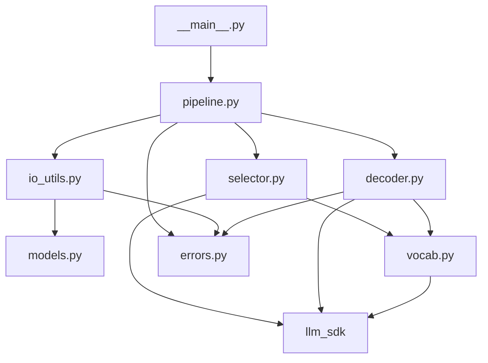
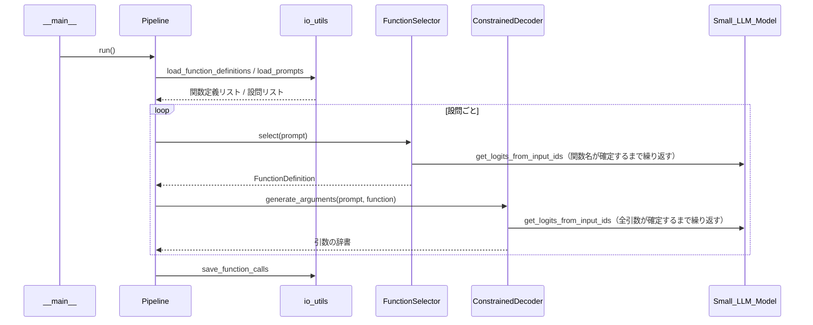

# 方式設計書：call me maybe

## 1. 目的と範囲

本書は、課題「call me maybe」の実装本体（`src/`）の方式設計を定める。

- 本プログラムは、自然文の設問を「呼び出す関数名」と「引数」を持つ JSON に変換する。
- 本プログラムは、関数名と引数を LLM（Qwen/Qwen3-0.6B）に生成させる。
- 本プログラムは、制約付きデコードによって、出力 JSON の文法と型を 100% 保証する。

本書の対象は `src/` 配下の構成・責務・処理方式であり、README.md の記述内容は対象外とする。

## 2. 前提と制約

| 項目 | 内容 |
| --- | --- |
| 言語 | Python 3.10 以上 |
| 静的チェック | flake8、mypy（Makefile の lint ルールのオプション）をエラーなしで通過すること |
| 使用可能パッケージ | numpy、json、pydantic、llm_sdk（配布物） |
| 使用禁止パッケージ | pytorch、transformers、huggingface 系、outlines、dspy など |
| モデル | Qwen/Qwen3-0.6B（既定） |
| llm_sdk の制約 | private なメソッド・属性（`_` で始まるもの）は使用しない |
| 関数選択 | LLM が選択する。キーワード判定などのヒューリスティックは使わない |
| 性能目標 | 正解率 90% 以上、全設問の処理時間 5 分以内 |
| 環境構築 | 評価者は `uv sync` のみを実行する |

### 2.1 llm_sdk の利用メソッド

`Small_LLM_Model` クラスのうち、本プログラムは次の公開メソッドだけを使う。

| メソッド | 入力 | 出力 | 本プログラムでの用途 |
| --- | --- | --- | --- |
| `encode(text)` | 文字列 | トークン ID の 2 次元テンソル | 設問文と固定文字列のトークン化 |
| `get_logits_from_input_ids(input_ids)` | トークン ID のリスト | 次トークンの logits のリスト | 次トークンの候補ごとの点数の取得 |
| `get_path_to_vocab_file()` | なし | 語彙ファイルのパス | トークン ID と文字列の対応表の作成 |

## 3. 全体構成

### 3.1 ディレクトリ構成

```
000/
├── Makefile
├── pyproject.toml
├── uv.lock
├── README.md
├── .gitignore
├── llm_sdk/                 # 配布物のコピー
├── data/
│   └── input/
│       ├── functions_definition.json
│       └── function_calling_tests.json
└── src/
    ├── __init__.py
    ├── __main__.py          # 受付係
    ├── errors.py            # 独自例外
    ├── models.py            # pydantic モデル
    ├── io_utils.py          # 読み書き係
    ├── vocab.py             # 辞書係
    ├── selector.py          # 選択係
    ├── decoder.py           # 生成係
    └── pipeline.py          # 進行係
```

`data/output/` は実行時に生成し、リポジトリには含めない。

### 3.2 モジュールの依存関係

矢印は「呼び出す側 → 呼び出される側」を表す。



## 4. 各モジュールの責務

### 4.1 `__main__.py`（受付係）

**役割**：プログラムの入口。コマンドライン引数で受け取ったファイルパスを `Pipeline` に渡し、エラー発生時はメッセージを表示して終了コード 1 で終了する。

- `main()` は、コマンドライン引数を argparse で解析し、3 つのファイルパスを `Pipeline` に渡す。
- `main()` は、`CallMeMaybeError` を捕捉したとき、エラーメッセージを標準エラー出力に表示して終了コード 1 を返す。

| 引数 | 既定値 |
| --- | --- |
| `--functions_definition` | `data/input/functions_definition.json` |
| `--input` | `data/input/function_calling_tests.json` |
| `--output` | `data/output/function_calling_results.json` |

### 4.2 `errors.py`（独自例外）

**役割**：本プログラム専用のエラーの種類（入力・出力・モデル・生成）を定義する。

| 例外クラス | 親クラス | 送出する場面 |
| --- | --- | --- |
| `CallMeMaybeError` | `Exception` | 本プログラムの全例外の基底 |
| `InputFileError` | `CallMeMaybeError` | 入力ファイルが存在しない、JSON として不正、またはスキーマに合わない |
| `OutputFileError` | `CallMeMaybeError` | 出力ファイルに書き込めない |
| `ModelError` | `CallMeMaybeError` | モデルまたは語彙ファイルの読み込みに失敗した |
| `DecodingError` | `CallMeMaybeError` | 生成中に許可トークンが 1 つもなくなった、または値が完成しなかった |

### 4.3 `models.py`（pydantic モデル）

**役割**：関数定義・設問・出力結果のデータの形を定義し、形が合わないデータを拒否する。

各モデルは `model_config = ConfigDict(extra="forbid")` を指定し、未知のキーを拒否する。

| クラス | フィールド | 役割 |
| --- | --- | --- |
| `ParameterSpec` | `type: Literal["number", "integer", "string", "boolean"]` | 引数 1 個または戻り値の型 |
| `FunctionDefinition` | `name: str`、`description: str`、`parameters: dict[str, ParameterSpec]`、`returns: ParameterSpec` | 関数定義ファイルの要素 1 件 |
| `PromptItem` | `prompt: str` | 設問ファイルの要素 1 件 |
| `FunctionCall` | `prompt: str`、`name: str`、`parameters: dict[str, float \| int \| str \| bool]` | 出力ファイルの要素 1 件 |

### 4.4 `io_utils.py`（読み書き係）

**役割**：関数定義ファイルと設問ファイルを読み込み、結果を JSON ファイルに保存する。

| 関数 | 入力 | 出力 |
| --- | --- | --- |
| `load_function_definitions(path)` | 関数定義ファイルのパス | `list[FunctionDefinition]` |
| `load_prompts(path)` | 設問ファイルのパス | `list[PromptItem]` |
| `save_function_calls(path, calls)` | 出力ファイルのパスと `list[FunctionCall]` | なし（ファイルに保存） |

- 読み込み関数は、`FileNotFoundError`・`json.JSONDecodeError`・`pydantic.ValidationError` を `InputFileError` に変換して送出する。
- `save_function_calls` は、出力先の親ディレクトリが無ければ作成し、`json.dump(..., indent=2, ensure_ascii=False)` で保存する。
- ファイル操作は、すべて `with` 文（コンテキストマネージャ）で行う。

### 4.5 `vocab.py`（辞書係）

**役割**：トークン ID（モデルが扱う番号）と実際の文字列の対応表を作る。

- `Vocab` クラスは、`get_path_to_vocab_file()` が返す語彙ファイル（`vocab.json`）を読み込む。
- `Vocab` クラスは、「トークン ID → 実際の文字列」の対応表 `id_to_text: dict[int, str]` を作る。
- 語彙ファイルのキーはバイトレベル BPE の表記（例：`Ġis` の `Ġ` は先頭の空白）で書かれている。`Vocab` クラスは、この表記をバイト列に戻してから UTF-8 で文字列に変換する。
- `Vocab` クラスは、起動時に一度だけ、用途別の許可トークン集合を計算する（7 章参照）。

### 4.6 `selector.py`（選択係）

**役割**：設問 1 件に対して、呼び出すべき関数を 1 つ選ぶ。

- `FunctionSelector.select(prompt)` は、設問 1 件を受け取り、関数定義ファイルに載っている関数の中から 1 つを選んで `FunctionDefinition` を返す。
- 選択方式は 6.1 節に示す。

### 4.7 `decoder.py`（生成係）

**役割**：選ばれた関数の引数の値を、型に合うように制限しながらモデルに生成させる。

- `ConstrainedDecoder.generate_arguments(prompt, function)` は、設問と選ばれた関数を受け取り、引数の辞書 `dict[str, float | int | str | bool]` を返す。
- 生成方式は 6.2 節に示す。

### 4.8 `pipeline.py`（進行係）

**役割**：読み込み → モデル準備 → 設問ごとの関数選択・引数生成 → 保存という全体の流れを順番に実行する。

- `Pipeline.run()` は、次の処理を 1 件目から最後の設問まで順に実行する。
  1. `io_utils` で関数定義と設問を読み込む。
  2. `Small_LLM_Model` と `Vocab` を初期化する。
  3. 設問ごとに `FunctionSelector.select` → `ConstrainedDecoder.generate_arguments` を実行し、`FunctionCall` を作る。
  4. `io_utils.save_function_calls` で全件を保存する。
- `Pipeline.run()` は、設問ごとの処理時間と全体の処理時間を標準エラー出力に表示する。

## 5. 処理フロー



## 6. 制約付きデコードの方式

### 6.1 共通の手順

LLM が 1 トークンを選ぶたびに、本プログラムは次の手順を実行する。

1. `get_logits_from_input_ids` で、全トークンの logits を numpy 配列として受け取る。
2. 現在の状態で許可されないトークンの logits を `-inf` にする。
3. 残ったトークンのうち、logits が最大のトークンを選ぶ（greedy 方式）。
4. 選んだトークン ID を入力列の末尾に追加し、状態を更新する。

### 6.2 関数の選択（selector.py）

1. 本プログラムは、関数一覧（名前と説明）・設問・`"name": "` までを含むプロンプト文を作る。
2. 候補文字列は「関数名 + `"`」とする。末尾に `"` を付けることで、`fn_add` と `fn_add_numbers` のように一方が他方の先頭部分になる場合も区別できる。
3. 各ステップの許可トークンは、「生成済み文字列 + トークン文字列」がいずれかの候補の先頭部分になるトークンとする。
4. 生成済み文字列が候補のどれかと完全に一致した時点で、選択を終了する。

この方式では、選ばれる関数は必ず関数定義ファイルに載っている関数になる。また、どの関数を選ぶかは LLM の logits だけで決まる。

### 6.3 引数の生成（decoder.py）

#### 固定部分の自動挿入

キー名と記号（`{`、`"a": `、`, `、`}`）は関数定義から決まるため、本プログラムが自動で入力列に追加する。LLM が生成するのは各引数の「値」の部分だけである。

```
{"a": [値を生成], "b": [値を生成]}
      ↑自動挿入     ↑自動挿入      ↑自動挿入
```

#### 型ごとの状態機械

| 型 | 許可する文字列の形 | 終了条件 | 変換後の型 |
| --- | --- | --- | --- |
| `number` | `-?[0-9]*(\.[0-9]*)?` の先頭部分 | 値が `-?[0-9]+(\.[0-9]+)?` として完成しており、終端トークン（`,` または `}`）が選ばれた | `float` |
| `integer` | `-?[0-9]*` の先頭部分 | 値が `-?[0-9]+` として完成しており、終端トークンが選ばれた | `int` |
| `string` | `"` を含まない文字列 | 閉じの `"` を含むトークンが選ばれた | `str` |
| `boolean` | `true` または `false` の先頭部分 | `true` または `false` に完全一致した | `bool` |

- 本プログラムは、終端トークンそのものは値に含めず、次の固定部分を自動挿入する。
- 文字列の値は、生の文字列として保持する。出力時のエスケープ（`\` → `\\` など）は `json.dump` が行うため、出力 JSON は常に正しい形式になる。
- 値 1 個あたりの生成トークン数には上限（例：64 トークン）を設ける。上限に達しても値が完成しない場合、`ConstrainedDecoder` は `DecodingError` を送出する。

#### 既知の制約

- 文字列の値に `"` を含めることはできない（`"` を終端として扱うため）。

## 7. 性能対策

- `get_logits_from_input_ids` は呼び出しごとに入力列全体を計算し直すため、呼び出し回数を減らすことが最も効果的である。
  - 固定部分を自動挿入することで、LLM の呼び出しを「値」のトークン数だけに抑える。
- `Vocab` クラスは、起動時に次の許可トークン集合を numpy の真偽値配列（マスク）として一度だけ作る。
  - 数字・`-`・`.` だけで構成されるトークンの集合
  - `"` を含まないトークンの集合
  - 末尾だけに `"` を含むトークンの集合
- 生成中の各ステップは、上記マスクの参照と、状態に応じた絞り込みだけで行う。
- 設問文のトークン化（`encode`）は、設問 1 件につき 1 回だけ行う。

## 8. エラー処理方針

| 発生箇所 | 例 | 対応 |
| --- | --- | --- |
| 引数解析 | 未知のオプション | argparse が使い方を表示して終了する |
| 入力ファイル | ファイルが無い、JSON が壊れている、キーが足りない | `InputFileError` を送出し、`main()` がメッセージを表示して終了コード 1 で終了する |
| モデル初期化 | モデルや語彙ファイルを読み込めない | `ModelError` を送出し、`main()` が終了コード 1 で終了する |
| 設問 1 件の生成 | 値が完成しない | `Pipeline` が `DecodingError` を捕捉して警告を表示し、その設問を飛ばして次の設問に進む |
| 出力ファイル | 書き込み権限が無い | `OutputFileError` を送出し、`main()` が終了コード 1 で終了する |

本プログラムは、想定外の例外であっても、トレースバックではなく分かりやすいメッセージを表示して終了する。

## 9. 実行方法と Makefile

### 9.1 実行コマンド

```
uv run python -m src \
  --functions_definition data/input/functions_definition.json \
  --input data/input/function_calling_tests.json \
  --output data/output/function_calling_results.json
```

### 9.2 Makefile のルール

| ルール | 実行内容 |
| --- | --- |
| `install` | `uv sync` |
| `run` | `uv run python -m src` |
| `debug` | `uv run python -m pdb -m src` |
| `clean` | `__pycache__`、`.mypy_cache`、`.pytest_cache` の削除 |
| `lint` | `flake8 .` と `mypy . --warn-return-any --warn-unused-ignores --ignore-missing-imports --disallow-untyped-defs --check-untyped-defs` |
| `lint-strict`（任意） | `flake8 .` と `mypy . --strict` |

### 9.3 依存関係（pyproject.toml）

- `dependencies` に `numpy`、`pydantic`、`llm-sdk` を記載する。
- `llm-sdk` は `[tool.uv.sources]` でローカルパス `llm_sdk` を指定する。

## 10. テスト方針

テストコードは提出対象外とし、`tests/` ディレクトリに pytest で作成する。

| 対象 | 確認内容 |
| --- | --- |
| `models.py` | 不正な型・未知のキー・必須キーの欠落を拒否すること |
| `io_utils.py` | ファイルが無い場合と JSON が壊れている場合に `InputFileError` を送出すること |
| `vocab.py` | `Ġ` などのバイトレベル表記を正しい文字列に戻せること |
| `decoder.py` | 偽の logits を返すスタブモデルを使い、各型の状態機械が不正なトークンを選ばないこと |
| 全体 | 空文字列、大きな数値、特殊文字、複数引数の関数、曖昧な設問で、出力が常に正しい JSON になること |
